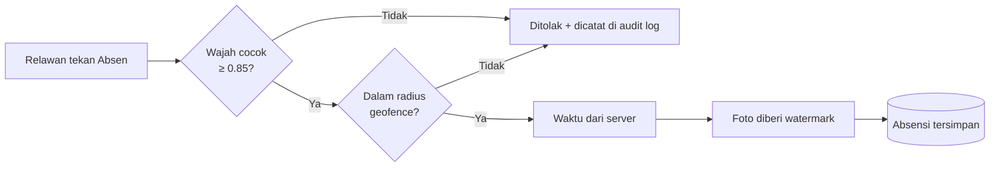

# 🧾 Sistem Absensi & Payroll Relawan SPPG Curug Cukanggalih 02


Aplikasi web **absensi** dan **penggajian (payroll) otomatis** untuk relawan SPPG Curug Cukanggalih 02, dibangun dengan **Laravel 12**.

Validitas kehadiran dijaga lewat **3 lapis keamanan**:

| # | Lapisan | Teknologi |
|---|---------|-----------|
| 1 | Verifikasi wajah + liveness | ARSA Face API |
| 2 | Geofencing | Rumus Haversine |
| 3 | Watermark foto & timestamp server | PHP GD (server-side) |

---

## 📑 Daftar Isi

- [Stack Teknologi](#-stack-teknologi)
- [Fitur Utama](#-fitur-utama)
- [Role & Hak Akses](#-role--hak-akses)
- [Instalasi](#-instalasi)
- [Konfigurasi `.env`](#️-konfigurasi-env)
- [Akun Default](#-akun-default-seeder)
- [Struktur Database](#️-struktur-database)
- [Kalkulasi Honor Payroll](#-kalkulasi-honor-payroll)
- [Routes Utama](#-routes-utama)
- [Cara Penggunaan](#-cara-penggunaan)
- [Keamanan](#-keamanan)
- [Deployment di Shared Hosting](#-deployment-di-shared-hosting)
- [Changelog](#-changelog)

---

## 🧰 Stack Teknologi

| Komponen | Teknologi |
|---|---|
| Backend | Laravel 12, PHP 8.2 |
| Frontend | Bootstrap 5, Bootstrap Icons, Chart.js |
| Database | MySQL (production), SQLite (development) |
| Autentikasi | Laravel Session-based Auth |
| Verifikasi Wajah | ARSA Face API (tersedia mode dummy) |
| Notifikasi WhatsApp | Fonnte API (tersedia mode dummy) |
| PDF | `barryvdh/laravel-dompdf` |
| Watermark | PHP GD (native, tanpa library eksternal) |
| Hosting | Siap untuk shared hosting (Hostinger) |

---

## ✨ Fitur Utama

### 🔐 3 Lapis Keamanan Absensi

1. **Verifikasi Wajah + Liveness** — via ARSA Face API, threshold `0.85`.
2. **Geofencing Haversine** — radius dikonfigurasi admin (default 100 m).
3. **Server Timestamp** — waktu absensi diambil dari server, tidak bisa dimanipulasi klien.



### 📦 Modul yang Tersedia

**Absensi**
- ✅ Autentikasi 3 role: Super Admin, Admin, Relawan
- ✅ Enrollment wajah relawan
- ✅ Absensi masuk & pulang (wajah + GPS)
- ✅ Watermark foto server-side (nama, NIK, divisi, waktu, koordinat, jarak)
- ✅ Absensi manual oleh admin (input / hapus kehadiran per relawan per tanggal)
- ✅ Pengajuan izin / sakit / cuti + upload lampiran

**Payroll**
- ✅ Manajemen divisi & jadwal kerja (1 jadwal tunggal per divisi, berlaku semua hari)
- ✅ Komponen honor per divisi (honor harian, transport, uang makan, lembur, potongan)
- ✅ Generate payroll otomatis per periode
- ✅ Approve payroll + notifikasi WA slip gaji ke relawan
- ✅ Download slip gaji PDF per relawan
- ✅ Export rekap payroll ke CSV

**Monitoring & Laporan**
- ✅ Dashboard admin dengan grafik tren 7 hari & fraud detection
- ✅ Laporan kehadiran bulanan (export PDF & Excel/CSV)
- ✅ Audit log semua percobaan absensi (berhasil & gagal)
- ✅ Alert WA ke admin saat relawan gagal absen 3× berturut-turut

---

## 👥 Role & Hak Akses

| Fitur | Super Admin | Admin | Relawan |
|---|:---:|:---:|:---:|
| Konfigurasi sistem (koordinat, API key, radius) | ✅ | ❌ | ❌ |
| Manajemen user | ✅ | ✅ | ❌ |
| Manajemen divisi, jadwal & honor | ✅ | ✅ | ❌ |
| Absensi manual | ✅ | ✅ | ❌ |
| Approve izin | ✅ | ✅ | ❌ |
| Generate & approve payroll | ✅ | ✅ | ❌ |
| Laporan kehadiran | ✅ | ✅ | ❌ |
| Absensi (wajah & GPS) | ❌ | ❌ | ✅ |
| Pengajuan izin | ❌ | ❌ | ✅ |
| Lihat & download slip gaji | ❌ | ❌ | ✅ |

---

## 🚀 Instalasi

### Prasyarat

- PHP ≥ 8.2
- Composer
- MySQL
- Ekstensi PHP: `GD`, `cURL`, `mbstring`, `xml`

### Langkah

```bash
# 1. Clone / extract project
cd Absensi_vermuk

# 2. Install dependency
composer install

# 3. Salin environment & generate app key
cp .env.example .env
php artisan key:generate

# 4. Atur database di .env (lihat bagian Konfigurasi)

# 5. Migration + seeder
php artisan migrate --seed

# 6. Symlink storage
php artisan storage:link

# 7. Jalankan server
php artisan serve
```

Aplikasi berjalan di `http://127.0.0.1:8000`.

---

## ⚙️ Konfigurasi `.env`

```env
# --- Database ---
DB_CONNECTION=mysql
DB_HOST=127.0.0.1
DB_PORT=3306
DB_DATABASE=absensisppg
DB_USERNAME=root
DB_PASSWORD=your_password

# --- Mode development ---
# false = bebas absen kapan pun (bypass validasi jadwal)
SCHEDULE_CHECK=false

# --- ARSA Face API ---
# dummy = tidak memakai kuota, real = API asli
FACE_API_MODE=dummy
ARSA_API_KEY=

# --- Fonnte WhatsApp API ---
# dummy = hanya log, real = kirim WA sungguhan
FONNTE_API_MODE=dummy
FONNTE_API_TOKEN=

# --- Lokasi SPPG (bisa diubah via Pengaturan Sistem) ---
SPPG_LATITUDE=-6.2577369
SPPG_LONGITUDE=106.5500299
GEOFENCE_RADIUS_METERS=100
```

### ✅ Checklist sebelum demo / sidang / production

| Variabel | Development | Demo / Production |
|---|---|---|
| `FACE_API_MODE` | `dummy` | `real` |
| `FONNTE_API_MODE` | `dummy` | `real` |
| `SCHEDULE_CHECK` | `false` | `true` |
| `APP_ENV` | `local` | `production` |
| `APP_DEBUG` | `true` | **`false`** |

> ⚠️ Pastikan `APP_DEBUG=false` di production. Jika `true`, halaman error menampilkan stack trace, versi framework, header, dan cookie ke pengunjung (terlihat pada laporan ZAP).

---

## 🔑 Akun Default (Seeder)

| Role | Email | Password |
|---|---|---|
| Super Admin | `superadmin@sppg.local` | `superadmin123` |
| Admin | `admin@sppg.local` | `admin123` |
| Relawan 1 | `siti@sppg.local` | `relawan123` |
| Relawan 2 | `budi@sppg.local` | `relawan123` |
| Relawan 3 | `rina@sppg.local` | `relawan123` |

> 🔒 **Akun ini hanya untuk development.** Ganti semua password (terutama Super Admin & Admin) sebelum aplikasi diakses publik.

---

## 🗄️ Struktur Database

| Tabel | Keterangan |
|---|---|
| `users` | Data user semua role |
| `divisions` | Divisi + jadwal + semua komponen honor (`daily_rate`, `daily_transport`, `meal_allowance`, `overtime_hourly_rate`, `late_deduction`) |
| `work_schedules` | Jadwal kerja per divisi (1 record `NULL` = berlaku semua hari) |
| `face_embeddings` | Embedding wajah terenkripsi |
| `attendances` | Data absensi masuk & pulang |
| `attendance_logs` | Audit log semua percobaan absensi |
| `leave_requests` | Pengajuan izin / sakit / cuti |
| `payrolls` | Header payroll per periode |
| `payroll_details` | Detail honor per relawan per payroll |
| `salary_schemes` | Skema fallback global (jika divisi belum diatur) |
| `settings` | Konfigurasi sistem (koordinat, radius, API key) |

---

## 💰 Kalkulasi Honor Payroll

```text
Honor Pokok  = daily_rate (divisi)            × Hari Hadir
Transport    = daily_transport (divisi)       × Hari Hadir
Uang Makan   = meal_allowance (divisi)        × Hari dengan jam kerja ≥ 6 jam
Lembur       = overtime_hourly_rate (divisi)  × Total jam > 8 jam/hari
Potongan     = late_deduction (divisi)        × Jumlah keterlambatan
──────────────────────────────────────────────────────────────────
Total Bersih = Honor Pokok + Transport + Uang Makan + Lembur − Potongan
```

Semua komponen dikonfigurasi **per divisi** di **Divisi & Jadwal → Edit Divisi**.

---

## 🛣️ Routes Utama

### Admin (`/admin/*`)

| Method | URL | Keterangan |
|---|---|---|
| GET | `/admin/dashboard` | Dashboard & statistik |
| GET / POST | `/admin/divisions` | Manajemen divisi |
| GET / PUT | `/admin/divisions/{id}/edit` | Edit divisi, jadwal & honor |
| GET | `/admin/relawan` | Daftar relawan |
| GET / POST | `/admin/absensi-manual` | Absensi manual oleh admin |
| GET | `/admin/izin` | Permohonan izin |
| GET | `/admin/payroll` | Daftar payroll |
| GET | `/admin/payroll/generate` | Form generate payroll |
| POST | `/admin/payroll/generate` | Proses generate payroll |
| GET | `/admin/payroll/{id}` | Detail payroll |
| PATCH | `/admin/payroll/{id}/approve` | Approve + kirim WA |
| GET | `/admin/payroll/{id}/export-csv` | Export CSV |
| GET | `/admin/payroll/slip/{detail}/pdf` | Download slip PDF |
| GET | `/admin/laporan` | Laporan kehadiran |
| GET | `/admin/laporan/export-pdf` | Export PDF laporan |
| GET | `/admin/laporan/export-excel` | Export CSV laporan |
| GET / POST | `/admin/pengaturan` | Pengaturan sistem *(Super Admin only)* |

### Relawan (`/relawan/*`)

| Method | URL | Keterangan |
|---|---|---|
| GET | `/relawan/dashboard` | Dashboard relawan |
| GET / POST | `/relawan/enrollment` | Pendaftaran wajah |
| GET / POST | `/relawan/absensi` | Halaman & proses absensi |
| GET / POST | `/relawan/izin` | Pengajuan izin |
| GET | `/relawan/payroll` | Daftar slip honor |
| GET | `/relawan/payroll/slip/{id}` | Download slip PDF |

---

## 📖 Cara Penggunaan

### Alur Admin

1. Login sebagai **Admin**.
2. **Divisi & Jadwal** → tambah divisi → isi Honor Harian, Transport, Uang Makan, Lembur.
3. **Data Relawan** → tambah relawan → assign ke divisi.
4. Relawan melakukan enrollment wajah dan mulai absensi.
5. **Payroll & Honor** → Generate Payroll → pilih periode → Kalkulasi.
6. Review draft → **Approve & Kirim WA** → relawan menerima notifikasi WA.
7. Setelah transfer → **Tandai Lunas**.

### Alur Relawan

1. Login → **Daftarkan Wajah** (enrollment).
2. Buka **Absensi** → izinkan akses kamera & GPS.
3. Klik **Absen Masuk** → wajah + GPS diverifikasi → foto berwatermark tersimpan.
4. Setelah jam kerja → **Absen Pulang**.
5. Lihat slip honor di **Slip Honor Saya**.

---

## 🛡️ Keamanan

Fitur keamanan yang sudah diterapkan:

- **Rate limiting** — login 5 req/menit, absensi 10 req/menit.
- **`SecurityHeadersMiddleware`** — CSP, X-Frame-Options, X-Content-Type-Options, X-XSS-Protection, Referrer-Policy, dan Cache-Control untuk halaman sensitif (hasil temuan ZAP).
- **SRI (Subresource Integrity)** pada CDN Bootstrap di layout.
- **Embedding wajah terenkripsi** dan audit log semua percobaan absensi.
- **Pembatasan akses per role** (Super Admin / Admin / Relawan).

Rekomendasi tambahan untuk server production:

- Set `APP_DEBUG=false` dan ganti seluruh password akun seeder.
- Sembunyikan versi PHP: `expose_php = Off` di `php.ini` dan hapus header `X-Powered-By`.
- Gunakan versi PHP 8.2 terbaru yang masih menerima patch keamanan.
- Aktifkan HTTPS dan header `Strict-Transport-Security`.
- Pastikan cookie sesi memakai `HttpOnly` dan `Secure` (cek `config/session.php`).

---

## 🌐 Deployment di Shared Hosting

| Masalah | Solusi |
|---|---|
| Kuota ARSA (100/bulan) habis saat testing | Pakai `FACE_API_MODE=dummy`, ganti ke `real` H-1 sidang |
| Timeout upload foto | Set `max_execution_time=120` dan `upload_max_filesize=10M` di konfigurasi PHP hPanel |
| GPS kurang akurat di dalam gedung | Naikkan radius geofencing via Pengaturan Sistem |

---

## 📝 Changelog

### v2.0 (November 2026)

**Fitur**
- Refactor jadwal kerja: dari 6 jadwal/hari menjadi 1 jadwal tunggal per divisi.
- Honor per divisi: kolom `daily_rate`, `daily_transport`, `meal_allowance`, `overtime_hourly_rate`, `late_deduction` di tabel `divisions`; semua dikonfigurasi di halaman Edit Divisi.
- Menu "Skema Honor" terpisah di sidebar dihapus.
- Grafik tren 7 hari (Chart.js) di dashboard admin.
- Export laporan kehadiran ke PDF & CSV.
- Fitur Absensi Manual oleh Admin (checkbox per relawan per tanggal).
- Rate limiting: login (5 req/menit), absensi (10 req/menit).
- Seeder diperbarui: 46 data relawan riil dan 5 divisi sesuai jabatan.
- `SCHEDULE_CHECK=false` di `.env` untuk bypass validasi jadwal saat development.

**Keamanan (berdasarkan laporan ZAP)**
- Tambah `SecurityHeadersMiddleware` (CSP, X-Frame-Options, X-Content-Type-Options, X-XSS-Protection, Referrer-Policy, Cache-Control).
- Tambah atribut SRI pada CDN Bootstrap.

**Perbaikan bug**
- `use Illuminate\Support\Str` yang hilang di `PayrollController`.
- N+1 query pada approve payroll.
- Alert WhatsApp kini hanya dikirim tepat pada percobaan gagal ke-3.
- Relawan tanpa divisi tidak lagi bisa absen.
- Migration kompatibel dengan SQLite & MySQL.

### v1.0 (November 2026)

- Rilis awal: absensi wajah + GPS, watermark, payroll, izin, notifikasi WA.
